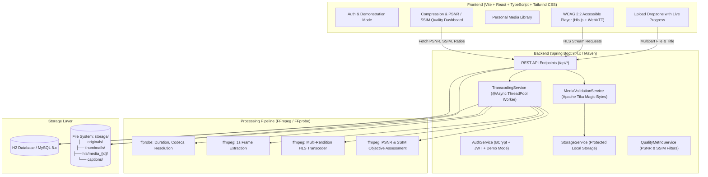

# MediaFlow: Adaptive Multimedia Streaming and Compression System

[](https://www.oracle.com/java/)
[](https://spring.io/projects/spring-boot)
[](https://vitejs.dev/)
[](https://react.dev/)
[](https://www.typescriptlang.org/)
[](https://ffmpeg.org/)
[](https://www.w3.org/WAI/standards-guidelines/wcag/)

> **MediaFlow** is a full-stack multimedia processing, adaptive delivery, and quality evaluation platform designed for e-learning repositories, student showcases, and educational institutions. It unifies media upload, magic-byte validation, automated background transcoding into an adaptive multi-bitrate ladder, HTTP Live Streaming (HLS) packaging, WebVTT captions, accessible player controls, and objective compression evaluation (PSNR and SSIM) into a single web application.

---

## 🏛️ High-Altitude System Architecture



---

## 📂 Subsystem Directory Layout

| Directory | Subsystem Contract | Technology Stack |
| :--- | :--- | :--- |
| [`/Backend`](file:///d:/Git/MediaFlow/Backend/README.md) | Asynchronous transcoding pipeline, REST APIs, HLS streaming, database persistence, and Tika validation. | Java 21, Spring Boot 3.4.2, Maven, Spring Data JPA, H2 / MySQL, FFmpeg, Apache Tika, JWT. |
| [`/Frontend`](file:///d:/Git/MediaFlow/Frontend/README.md) | Accessible client application, Hls.js video player, upload dropzone, and quality telemetry visualizations. | React 18, TypeScript, Vite 6, Tailwind CSS, Lucide Icons, Axios, Hls.js. |

---

## 📐 Adaptive Bitrate (ABR) Encoding Ladder

Conforming to Section 3.4.3 of the project report, video uploads are transcoded into an adaptive multi-bitrate ladder. The pipeline enforces the **Resolution Constraint Invariant**: *the system never allows a rendition to exceed the source video's native resolution*.

| Rendition | Resolution | Video Bitrate | Audio Bitrate | Target Audience / Device |
| :--- | :--- | :--- | :--- | :--- |
| **Low** | 426 x 240 | ~400 kbps | AAC 64 kbps | Weak / constrained mobile connections |
| **Medium** | 640 x 360 | ~800 kbps | AAC 96 kbps | Default for small mobile displays |
| **Standard** | 854 x 480 | ~1400 kbps | AAC 128 kbps | General standard-definition viewing |
| **HD** | 1280 x 720 | ~2800 kbps | AAC 128 kbps | Laptops, tablets, high-speed networks |
| **Full HD** | 1920 x 1080| ~5000 kbps | AAC 128 kbps | Large monitors (generated only if source $\ge$ 1080p) |

---

## 🧪 Functional Verification Test Matrix (Table 4.2 in Report)

| Test ID | Category | Test Input / Action | Expected Output | Status |
| :--- | :--- | :--- | :--- | :--- |
| **T01** | Upload validation | Upload supported video within limits | File is accepted, metadata extracted, queued job created | **Verified** |
| **T02** | Type validation | Upload unsupported file or renamed `.txt` to `.mp4` | Rejected with clear message via Tika magic bytes check; nothing stored | **Verified** |
| **T03** | Size limit | Upload file above 500 MB limit | Rejected with permitted limit shown | **Verified** |
| **T04** | Transcoding | Process sample video | Renditions created (up to source res) and listed in `master.m3u8` | **Verified** |
| **T05** | Resolution rule | Process 480p sample video | No rendition above 480p is generated (only 240p, 360p, 480p) | **Verified** |
| **T06** | Adaptive playback | Play processed video and throttle network in browser | Hls.js switches smoothly to lower rendition without stalling | **Verified** |
| **T07** | Manual quality | Select specific quality in player dropdown | Selected rendition plays until user changes it | **Verified** |
| **T08** | Captions | Attach WebVTT (`.vtt`) file to media | Captions appear in sync and can be toggled with 'C' key | **Verified** |
| **T09** | Keyboard access | Operate player using Space, K, Left/Right, Up/Down, F, M, C | All controls reachable with visible focus rings (WCAG 2.2) | **Verified** |
| **T10** | Compression report | Open compression report of processed file | Original size, output sizes, ratio, PSNR (dB), and SSIM appear | **Verified** |
| **T11** | Library privacy | Attempt to access another user's media URL | HTTP 403 Forbidden returned | **Verified** |
| **T12** | Failed job | Process corrupted video payload | Job marked FAILED with clear reason; no ready item created | **Verified** |
| **T13** | Responsive layout | Open screens on mobile (375px) and desktop (1440px) | Content remains readable and controls fully usable | **Verified** |
| **T14** | Deletion | Delete media item | Storage files (originals, HLS, thumbnails) and DB records cleaned up | **Verified** |

---

## 🚀 Quickstart Guide

### Prerequisites
- **Java Development Kit (JDK)**: Java 17, 21, or 25.
- **Apache Maven**: Version 3.8+.
- **Node.js**: Version 18+.
- **FFmpeg & FFprobe**: Available on system `PATH`.

### 1. Start the Spring Boot Backend
```bash
cd Backend
mvn spring-boot:run
```
*The backend starts at `http://localhost:8080`. By default, it initializes an embedded persistent H2 database in `./Backend/data/mediaflowdb`.*

### 2. Start the Vite React Frontend
```bash
cd Frontend
npm install
npm run dev
```
*The frontend starts at `http://localhost:5173`. Open this URL in any modern web browser.*

### 3. Immediate Demonstration Mode
Click **Launch Demonstration Mode** on the login screen to immediately explore the system without manual registration.

---

## 🎓 Academic Attribution
- **Institution**: K.S.R. College of Engineering (Autonomous), Tiruchengode, Tamil Nadu.
- **Department**: Department of Artificial Intelligence and Data Science.
- **Affiliation**: Anna University, Chennai.
